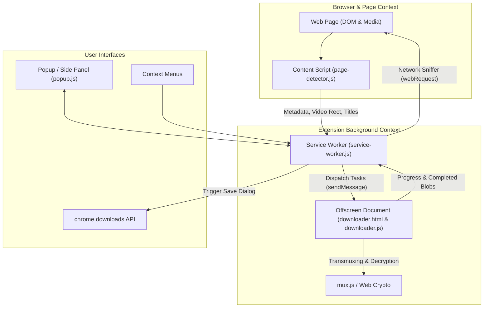

<div align="center">

# Open Video Downloader (OVD)

**A modern, lightweight, 100% open-source Manifest V3 browser extension for downloading web video and audio streams.**

*Zero Paywalls • Zero Watermarks • Zero Rate Limits • No External Companion Apps Required*

[](LICENSE)
[](manifest.json)
[](lib/mux.min.js)

</div>

---

## 🌟 Highlights & Advantages

Unlike proprietary extensions (such as Video DownloadHelper) that force users to install external companion apps (`vdhcoapp`), stamp massive QR-code watermarks on videos, impose 2-hour delays, or charge expensive recurring licenses:

- **100% Pure In-Browser Transmuxing**: Uses embedded `mux.js` to automatically convert fragmented MPEG-2 TS streams into standard, continuous **Fragmented MP4 (`.mp4`)** files directly in JavaScript. Plays smoothly in QuickTime, Chrome, VLC, Windows Media Player, iOS, and Android without stuttering or choppy playback.
- **Uninterrupted Background Downloads**: Built on Chrome's modern **Offscreen Document API**. Downloads continue seamlessly in the background when you switch tabs, minimize the browser, or close the popup.
- **Quality & Multi-Bitrate Selector**: Automatically parses HLS master playlists and provides a dropdown selector to choose between 1080p, 720p, 480p, 360p, or best quality.
- **1-Click Audio Extraction**: Extract and download audio-only tracks (`.m4a` / `.mp3`) directly with a single click.
- **Subtitles & Captions**: Automatically detects and downloads WebVTT (`.vtt`) and SRT (`.srt`) subtitle tracks.
- **3-Tier Real-Time Video Previews**: Eliminates broken thumbnails and CORS errors using a multi-tier preview engine (Tab Compositor Frame Capture + Stream Segment Extractor + DOM Poster Scanner).
- **Chrome Side Panel Mode**: Dock the downloader as a permanent side panel beside your webpage so you can browse, queue downloads, and monitor progress without the UI closing on click.
- **Built-in Ad & Tracker Noise Filtering**: Automatically ignores analytics pings, tracker beacons, and short ad clips (< 200 KB) from known advertising networks.
- **Zero Telemetry & 100% Private**: Runs entirely locally on your machine. No analytics, no tracking pixels, no remote server calls.

---

## 📋 Feature Comparison

| Feature | Video DownloadHelper (Commercial) | Open Video Downloader |
| :--- | :---: | :---: |
| **Price & Licensing** | $28.50+ / Freemium Gatekeep | **100% Free & Open Source (MIT)** |
| **Watermarks on Conversion** | ⚠️ Big QR code watermark on free tier | **None (Zero Watermarks)** |
| **External Native App Required** | ⚠️ Forces `vdhcoapp` native installer | **None (Pure in-browser JS)** |
| **Tab-Switching Download Survival** | Yes (via native binary) | **Yes (via MV3 Offscreen Engine)** |
| **HLS Stream Transmuxing** | CoApp / ffmpeg | **Built-in `mux.js` (MP4 output)** |
| **Quality Variant Picker** | Yes | **Yes (1080p, 720p, 480p, 360p)** |
| **Audio-Only Extraction** | Yes (watermarked on free tier) | **Yes (1-click `.m4a` / `.mp3`)** |
| **Subtitles Download** | Yes | **Yes (`.vtt`)** |
| **Chrome Side Panel Docking** | No | **Yes (`chrome.sidePanel`)** |
| **Context Menu Quick Download** | Yes | **Yes (Right-click to download)** |
| **CLI Command Generators** | No (raw URL only) | **Yes (`ffmpeg`, `yt-dlp`, `cURL`)** |
| **Tracking / Analytics** | Included | **Zero (100% local)** |

---

## 🏗️ Architecture (Manifest V3)

Open Video Downloader is engineered specifically for Chrome's Manifest V3 service-worker lifecycle:



1. **Background Service Worker (`background/service-worker.js`)**:
   - Passively sniffs network traffic via `chrome.webRequest` for media formats (`.m3u8`, `.mpd`, `.mp4`, `.webm`, `.mp3`, etc.).
   - Deduplicates HLS variant streams under their master playlist.
   - Manages download history, badges, and the offscreen document lifecycle.
2. **Offscreen Document (`background/downloader.html` & `downloader.js`)**:
   - Handles concurrent segment fetching, Web Crypto AES-128 decryption, and `mux.js` MP4 transmuxing.
   - Runs independently of the popup and active tab, ensuring downloads never abort when the user navigates or switches tabs.
3. **Content Script (`content/page-detector.js`)**:
   - Observes `<video>` and `<audio>` elements, extracts page titles and poster images, and coordinates compositor frame capture.
4. **Popup & Side Panel UI (`popup/popup.html` & `popup.js`)**:
   - Clean, modern dashboard featuring Detected Media, real-time download progress, quality selector, and completed download history.

---

## 🚀 Installation Guide

### Chrome / Brave / Edge / Opera / Vivaldi

1. Clone or download this repository:
   ```bash
   git clone https://github.com/Kanakjr/open-video-downloader.git
   ```
2. Open your browser's extension management page:
   - **Chrome / Brave**: `chrome://extensions/`
   - **Microsoft Edge**: `edge://extensions/`
   - **Opera**: `opera://extensions/`
3. Enable **Developer mode** (toggle switch in the top-right corner).
4. Click **Load unpacked**.
5. Select the `open-video-downloader` directory.
6. The Open Video Downloader icon will appear in your browser toolbar! (Pin it for easy access).

---

## 📖 How to Use

### 1. Downloading Video & Audio Streams
1. Navigate to any website with video or audio playback.
2. Click the **Open Video Downloader** icon in your toolbar.
3. If multiple quality options are available, choose your resolution (e.g., `1080p`, `720p`) from the dropdown.
4. Click **Download** (to save as smooth MP4) or **🎵 Audio** (to save audio only as M4A).
5. Switch tabs or minimize the browser — the badge will show live `%` download progress.

### 2. Docking into the Chrome Side Panel
- Click the **◨** (Side Panel) icon in the popup header, or right-click any page and select **Open Downloader in Side Panel**.
- The extension docks permanently on the right, letting you queue multiple downloads without the popup closing!

### 3. Quick Right-Click Download
- Right-click any video or audio player on the page and select **Download Video with Open Video Downloader**.

### 4. Exporting Terminal CLI Commands
- Click the **CLI** button on any card to copy ready-to-run `ffmpeg`, `yt-dlp`, or `cURL` commands with complete request headers.

---

## 🛠️ Supported Formats & Protocols

- **HTTP Live Streaming (HLS)**: `.m3u8` master and media playlists, multi-bitrate variants, AES-128 encryption, fragmented MP4 (`fMP4`), and MPEG-2 TS segments.
- **Dynamic Adaptive Streaming over HTTP (DASH)**: `.mpd` XML manifests.
- **Progressive Video**: `.mp4`, `.webm`, `.mkv`, `.mov`, `.flv`, `.avi`.
- **Progressive Audio**: `.mp3`, `.m4a`, `.aac`, `.ogg`, `.wav`, `.flac`.
- **Subtitles**: WebVTT (`.vtt`), SubRip (`.srt`).

---

## 🔒 Privacy & Permissions

Open Video Downloader requests only the permissions strictly required to detect and save media streams:

- `webRequest`: Sniff media response headers (`Content-Type`, `.m3u8`, etc.) without intercepting body content.
- `downloads`: Save completed video and audio files to your Downloads directory.
- `storage`: Store your download history locally on your device.
- `offscreen`: Run in-browser video transmuxing independently of the popup lifecycle.
- `sidePanel`: Dock the UI alongside web pages.
- `contextMenus`: Provide right-click download options.
- `<all_urls>`: Allow stream detection on any site you visit.

**Open Video Downloader does not collect, track, or transmit any user data or browsing activity.**

---

## ⚖️ Legal & Compliance Notice

- **No DRM Circumvention**: Open Video Downloader does **NOT** bypass, alter, or circumvent Digital Rights Management (DRM) technologies such as Widevine, PlayReady, or FairPlay. It only downloads publicly available, unencrypted, or clear-key streams.
- **Clean-Room Implementation**: This project is an independent, clean-room implementation built from scratch. It is not affiliated with, endorsed by, or derived from Video DownloadHelper or Mig Consultants.
- **Personal Use**: Please respect copyright laws and the terms of service of the content platforms you access. Use this tool only for content you own or have explicit permission to download.

---

## 📄 License

This project is licensed under the **MIT License**. See the [LICENSE](LICENSE) file for details.
